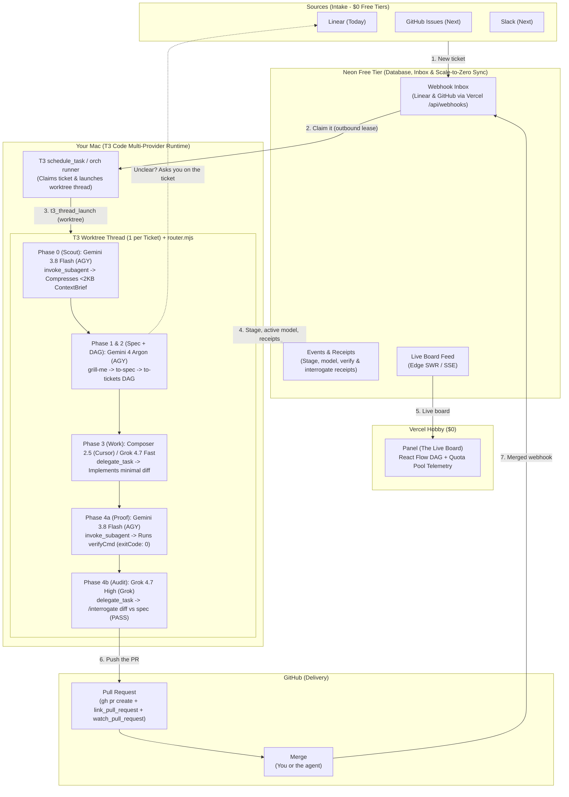

# Portable T3 Code Multi-Model Agent Factory (`pstack` + `mattpocock/skills` + Neon/Vercel Live Flow)

## Goal Description

Build a **configurable GitHub Template Repository (`cesarchavezcal/agent-factory`)** and **zero-API-key, zero-cost multi-model agent factory** (`orchestrator/`) orchestrated natively by **T3 Code** on your Mac that unifies:
1. **Configurable GitHub Template (`factory.config.json` + `orch doctor`)**:
   - Locked to GitHub account **`cesarchavezcal`** (`project.githubAccount: "cesarchavezcal"`, `invariants.requireGitHubAccount: "cesarchavezcal"`).
   - Portable repo-relative MCP configuration (`.cursor/mcp.json`), `.env.example`, `.github/PULL_REQUEST_TEMPLATE.md`, and `.github/workflows/factory-ci.yml`.
2. **Complete `mattpocock/skills` + `pstack` Dual Engine**:
   - **`mattpocock/skills` (Discovery & Specification — Gemini 4 Argon)**:
     - [`wayfinder`](file:///.agents/skills/wayfinder/SKILL.md), [`ask-matt`](file:///.agents/skills/ask-matt/SKILL.md), [`grill-me`](file:///.agents/skills/grill-me/SKILL.md), [`grill-with-docs`](file:///.agents/skills/grill-with-docs/SKILL.md), [`to-spec`](file:///.agents/skills/to-spec/SKILL.md), [`to-tickets`](file:///.agents/skills/to-tickets/SKILL.md), [`code-review`](file:///.agents/skills/code-review/SKILL.md), [`handoff`](file:///.agents/skills/handoff/SKILL.md).
   - **Lauren Tan's `pstack` (`cursor/plugins/pstack` — Composer 2.5 + Flash + Grok)**:
     - [`poteto-mode`](file:///.agents/skills/poteto-mode/SKILL.md), [`how`](file:///.agents/skills/how/SKILL.md), [`why`](file:///.agents/skills/why/SKILL.md), [`tdd`](file:///.agents/skills/tdd/SKILL.md), [`show-me-your-work`](file:///.agents/skills/show-me-your-work/SKILL.md), [`interrogate`](file:///.agents/skills/interrogate/SKILL.md), [`unslop`](file:///.agents/skills/unslop/SKILL.md), [`no-comments`](file:///.agents/skills/no-comments/SKILL.md), [`blast-radius`](file:///.agents/skills/blast-radius/SKILL.md), [`architect`](file:///.agents/skills/architect/SKILL.md), [`arena`](file:///.agents/skills/arena/SKILL.md), [`swarm`](file:///.agents/skills/swarm/SKILL.md), [`figure-it-out`](file:///.agents/skills/figure-it-out/SKILL.md), [`verify-and-interrogate`](file:///.agents/skills/verify-and-interrogate/SKILL.md).
3. **Outer-Loop Cloud Intake & Live Board ("The Whole Factory")**:
   - **Sources**: **Linear** (active today) and **GitHub Issues / Slack** (next) push webhooks into **Neon Free Tier** (`webhook_inbox`) via a $0 **Vercel Hobby** `/api/webhooks` route.
   - **Your Mac (`T3 Code` + `orch runner`)**: Claims tickets outbound from **Neon** (using scale-to-zero smart polling or T3 `schedule_task`), launches 1 isolated Git worktree thread per ticket (`t3_thread_launch` with `workspaceStrategy: { type: "worktree" }`), coordinates **Gemini + Cursor + Grok** via T3's `delegate_task` and `invoke_subagent`, streams stage/receipt telemetry to **Neon**, and opens/watches the **GitHub PR** under `cesarchavezcal` (`link_pull_request` + `watch_pull_request`).
   - **Dual Live Board**: Viewable locally at `http://localhost:4321` (Node SSE) and remotely on **Vercel** (`Panel` powered by Neon).

---

## 2-Stage Assembly Line Architecture

```
┌────────────────────────────────────────────────────────────────────────┐
│  STAGE 1: MACRO PLANNING (mattpocock/skills on Gemini 4 Argon)         │
│  Linear Ticket ──► /grill-me ──► /to-spec ──► /to-tickets (Tracer DAG) │
└───────────────────────────────────┬────────────────────────────────────┘
                                    │ Publishes DAG via orch_lock_spec_and_dag
┌───────────────────────────────────▼────────────────────────────────────┐
│  STAGE 2: MICRO EXECUTION (pstack on Composer 2.5 + Flash + Grok)      │
│  Unblocked Ticket                                                      │
│    ├─► /poteto-mode + /how + /tdd (Composer 2.5 / Grok 4.7 Fast)       │
│    ├─► show-me-your-work (Gemini 3.8 Flash verifyCmd: exit 0)          │
│    └─► /interrogate + /unslop (Grok 4.7 High: PASS)                    │
└───────────────────────────────────┬────────────────────────────────────┘
                                    │ Opens PR via link_pull_request
                                    ▼
                          GitHub PR (@cesarchavezcal)
```

---

## System Architecture & Process Flow ("The Whole Factory")



---

## Quota-Aware Model Routing Matrix (`Gemini` Plans/Verifies, `Cursor + Grok` Builds/Audits)

| Phase | Role | Provider (`providerInstanceId`) | Primary Model | Fallback Model (Quota/Disabled) | T3 Execution Mechanism | Token & Quota Justification |
| :--- | :--- | :--- | :--- | :--- | :--- | :--- |
| **Phase 0: Context Scout** | Repo search & file compression | `antigravity` (Pool A) | `gemini-3.8-flash-high` | `gemini-3.8-flash-medium` | `invoke_subagent({ Model: "flash" })` | Offloads ~20% repo-search token burn onto Flash so Argon never reads raw files. |
| **Phase 1: Discovery & Spec** | Ambiguity check & `docs/specs/<slug>.md` | `antigravity` (Pool A) | `gemini-4-argon-high` | `gemini-4-argon-medium` | Lead T3 Thread | Reads only the `<2KB` `ContextBrief` + ticket; asks on Linear if unclear (`orch_ask_ticket`). |
| **Phase 2: Playbook & DAG** | `pstack` playbook & `to-tickets` DAG | `antigravity` (Pool A) | `gemini-4-argon-high` | `gemini-3.8-flash-high` (for trivial bugfixes) | Lead T3 Thread (`orch_publish_dag`) | Synthesizes dependency-ordered sub-tickets + `verifyCmd` in the same turn as Phase 1. |
| **Phase 3a: Standard Work** | UI, React, CRUD, multi-file wiring | `cursor` (Pool B) | `composer-2.5` (`fastMode: true`) | `grok-4.7-build-fast` (`grok`) | `delegate_task({ role: "implementation" })` | Shifts the heaviest ~45% coding/edit loop token burn onto Cursor's native pool. |
| **Phase 3b: Complex Work** | DB schemas, concurrency, algorithms, rework | `grok` (Pool C) | `grok-4.7-build-fast` (`retryCount === 0`) / `grok-4.7` (`retryCount > 0`) | `composer-2.5` (`cursor`) | `delegate_task({ role: "implementation" })` | Uses Grok's strong first-principles reasoning on independent Pool C quota. |
| **Phase 4a: Runtime Proof** | Execute `verifyCmd` & parse test logs | `antigravity` (Pool A) | `gemini-3.8-flash-high` | `gemini-3.8-flash-low` | `invoke_subagent({ Model: "flash" })` | Digesting 1,000-line test logs costs near-zero quota on Flash; outputs clean `verifyReceipt`. |
| **Phase 4b: Interrogation** | `/interrogate` + `code-review` | `grok` (Pool C) | `grok-4.7` (`reasoningEffort: "high"`) | `grok-4.6` (`reasoningEffort: "high"`) | `delegate_task({ role: "review" })` | True cross-model adversarial gate (Grok auditing Composer/Gemini) on `<8KB` diff + spec. |
| **Phase 5: PR & Watch** | Push branch, open PR, watch CI | `antigravity` (Pool A) | `gemini-3.8-flash-high` | Lead Thread | `gh pr create` + `link_pull_request` + `watch_pull_request` | Native T3 PR lifecycle linking without polling loops. |

---

## Third-Party Cloud Services Setup & Ingestion Topology

Per [ADR-0005](file:///Users/cesaradalbertochavezcalderon/Personal/agent-factory/docs/adr/0005-guided-cli-cloud-setup-and-auto-migration.md) and [ADR-0009](file:///Users/cesaradalbertochavezcalderon/Personal/agent-factory/docs/adr/0009-third-party-cloud-services-setup-and-inbox-architecture.md):

1. **Neon Serverless Postgres**:
   - Free tier project created via web console (no CLI required).
   - Zero-dependency HTTP DDL schema application handled directly by `orch setup:cloud` and `neon-sync.mjs`.
   - Scale-to-zero adaptive idle backoff (<18 CU-hrs/month, $0 total cost).
2. **Vercel Serverless & Live Board**:
   - Hobby deployment with serverless endpoints (`/api/webhooks/linear`, `/api/webhooks/github`, `/api/events`).
   - `orch setup:cloud` exports `.env.production.local` with 1-click clipboard copy (`pbcopy`) for Vercel Project Settings.
   - Built-in 3-attempt exponential retry on webhooks absorbs Neon 1.5–2.5s cold starts.
3. **Linear & GitHub Webhook Sources**:
   - Cryptographic timing-safe HMAC verification (`Linear-Signature` & `X-Hub-Signature-256`).
   - Deduplicated intake with `ON CONFLICT (delivery_id) DO NOTHING`.
   - Outbound clarification comments use local authenticated `gh` (GitHub) and optional `LINEAR_API_KEY` with automatic fallback to local UI/terminal pause (`waiting_for_human`).

---

## Implemented Repository Structure

- [factory.config.json](file:///Users/cesaradalbertochavezcalderon/Personal/agent-factory/factory.config.json) & [factory.schema.json](file:///Users/cesaradalbertochavezcalderon/Personal/agent-factory/orchestrator/schema/factory.schema.json)
- [config.mjs](file:///Users/cesaradalbertochavezcalderon/Personal/agent-factory/orchestrator/src/engine/config.mjs) (`cesarchavezcal` account invariant + Claude-free + zero-API-key validator)
- [router.mjs](file:///Users/cesaradalbertochavezcalderon/Personal/agent-factory/orchestrator/src/engine/router.mjs) (Quota-aware routing across `AGY_FAST`, `AGY_PRO`, `CURSOR_WORK`, `GROK_WORK`, `GROK_AUDIT`)
- [state.mjs](file:///Users/cesaradalbertochavezcalderon/Personal/agent-factory/orchestrator/src/engine/state.mjs) (Atomic JSON state engine, `<2KB` Flash ContextBrief guard, dual PStack verification gates, and rework escalation)
- [neon-sync.mjs](file:///Users/cesaradalbertochavezcalderon/Personal/agent-factory/orchestrator/src/engine/neon-sync.mjs) (Scale-to-zero Neon Free Tier inbox & telemetry schema)
- [orch.mjs](file:///Users/cesaradalbertochavezcalderon/Personal/agent-factory/orchestrator/bin/orch.mjs) & [orch-mcp.mjs](file:///Users/cesaradalbertochavezcalderon/Personal/agent-factory/orchestrator/bin/orch-mcp.mjs) (CLI + stdio MCP server)
- [index.html](file:///Users/cesaradalbertochavezcalderon/Personal/agent-factory/orchestrator/src/ui/index.html) (Live SSE Mission Control UI)
- [factory.test.mjs](file:///Users/cesaradalbertochavezcalderon/Personal/agent-factory/orchestrator/tests/factory.test.mjs) (Automated test suite)
- [.agents/skills/](file:///Users/cesaradalbertochavezcalderon/Personal/agent-factory/.agents/skills) & [.cursor/skills/](file:///Users/cesaradalbertochavezcalderon/Personal/agent-factory/.cursor/skills) (Full 21 skills from `mattpocock/skills` and `pstack`)
- [.github/PULL_REQUEST_TEMPLATE.md](file:///Users/cesaradalbertochavezcalderon/Personal/agent-factory/.github/PULL_REQUEST_TEMPLATE.md) & [.github/workflows/factory-ci.yml](file:///Users/cesaradalbertochavezcalderon/Personal/agent-factory/.github/workflows/factory-ci.yml)
- [ADR Index](file:///Users/cesaradalbertochavezcalderon/Personal/agent-factory/docs/adr/) (ADR-0001 through ADR-0009)
